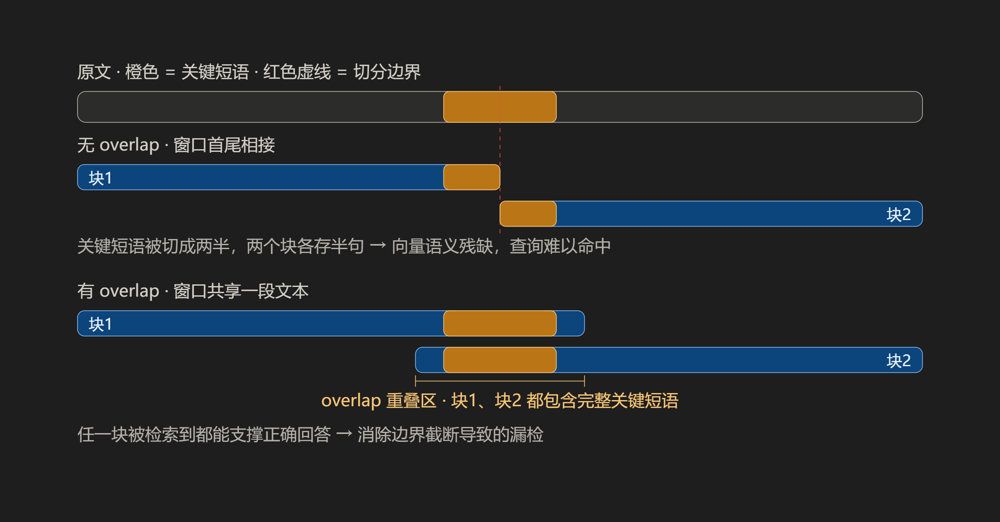

该文件是将load_file载入的文件进行切分

# 切分策略

这里包含多种切分策略：
* 固定大小切分
* 递归字符切分
* 结构化/语法感知切分
* 语义切分
* 父子块：不折中地破解块大小悖论
* 句子窗口检索
* 延迟分块：先读全文，再切块
* 特殊内容的切分

先给可以直接抄的答案，再讲怎么按自己的语料修正。以下 token 数指 embedding 模型的 token（中文约 1 token ≈ 0.7–1 字，按 512–1024 token ≈ 350–700 汉字估）[citation:19]。

## 速查表

| 场景 / 文档类型 | chunk_size | overlap | 备注 |
|---|---|---|---|
| **通用起点（先跑起来）** | 400–500 | 80–100 | 中文通用文档最稳的默认值 [citation:8][citation:18] |
| FAQ / 问答对 / 客服话术 | 200–300 | 20–50 | 一问一答本身就是完整语义单元 [citation:4] |
| 技术文档 / 报告 / 手册 | 500–800 | 100–120 | 需要容纳完整的技术解释 [citation:4][citation:18] |
| 长文分析 / 摘要类 | 800–1024 | 150–200 | 粒度粗，适合"论点+论据"整段召回 [citation:19][citation:20] |
| 精确事实查询（专有名词多） | 200–300 | 40–60 | 小块聚焦，配合 BM25 混合检索 |
| 代码文件 | 整函数/整类为单位 | — | 边界感知优先于长度 [citation:4] |
| 表格 | 整表保留 | — | 超长才切行并补表头 |

**区间共识**：多数基准和实践把最优粒度收敛在 **256–512 token、overlap 10%–20%** [citation:3][citation:10]；512–1024 是"信息完整性优先"的一档 [citation:6][citation:19]。

### 三条硬约束（先于经验值检查）

**1. Embedding 模型上限**。chunk_size 不能超过模型输入上限（bge 系列 512、bge-m3 8192、text-embedding-3 系列 8191）。超了会被静默截断，块尾内容根本没进向量——这是最常见的隐性 bug。

**2. 上下文预算公式**：

```
top_k × chunk_size × (1 + overlap率) ≤ 生成模型上下文预算的 50%
```

比如 top_k=5、chunk=500、overlap=15%，进提示词约 2900 token，长上下文模型无压力；如果 top_k 要开到 20，chunk 就得压到 250 以下。chunk_size 和 top_k 是**联动**的，分开调必然翻车 [citation:12]。

**3. 索引成本**。块数 ≈ 总 token / chunk_size。overlap 每加 10%，索引规模涨约 10%+；overlap 超 30% 时 chunk 数膨胀 40% 以上，还会让多个块检索得分趋同、互相稀释，一般不推荐 [citation:5]。

### chunk_size 变化的权衡曲线

```
chunk 小 (100-256)   → 聚焦、命中精确，但上下文不足，答案"断片"
chunk 大 (800-1500)  → 语义完整，但噪声多、精度降、浪费预算 [citation:5]
```

两个反直觉结论：

- **不是越大越准**。块里混进多个知识点，向量被"平均"，哪个查询都不像 [citation:5]
- **小块+合适重叠 也能打**。Chroma 的评测里，递归切分 200 token、零重叠在 text-embedding-3-large 上拿到 88.1% 召回，反而高于 800 token + 400 重叠的 85.4%（后者精度只有 1.5%）[citation:11]

另外策略本身的影响常大于数值微调：同一语料下语义分块（平均 642 token）召回 71%，固定字符切分（512）只有 59%，差 30% [citation:7]——所以先定"边界感知切分"，再抠 chunk_size。

**我的建议**：先用 `target=400 / overlap=60` 上线，跑第二步的网格评测（半天工作量）再定终值。真正拉开差距的往往不是这 ±100 token，而是切分有没有落在语义边界上、检索有没有上混合召回+重排 [citation:6][citation:9]。

## 固定长度切分

---

**overlap 的三大作用：**

1. 保住跨边界的关键信息（核心价值）​
如图，当答案恰好横跨切分点时，无重叠会把它拆进两个块——两个块的向量各只表达半句话，查询无论匹配哪边都「差一口气」，直接漏检。overlap 让相邻块共享一段文本，关键短语完整出现在每一个块里。
2. 让每块的开头不突兀
块边缘常出现半句话（示例里的「阶段。」「元数）」）。重叠区给块的首尾补上一点上下文，嵌入向量表达更完整。
3. 缓解嵌入边界效应
embedding 模型对文本开头/结尾的 token 更敏感，信息落在边缘时表征质量会打折。重叠降低了关键内容恰好落在边缘的概率。
---

**切分必须按 Token。 三个理由：**
1. 模型限制本来就以 Token 计。 嵌入模型有最大序列长度（如 512 或 8192 Token），超长输入被静默截断——被截掉的部分不进向量，但你以为进去了。
2. 字符与 Token 的比值随内容剧烈变化。 同一个 chunk_size = 500 在不同文本上的真实 Token 数（下表为估算，请用你自己的分词器实测）：
3. 成本与限流按 Token 计。 计费、限流、批大小上限都以 Token 为单位，按 Token 切才能让"每批多少块"直接可算。
---

**失效条件：**
文本里存在大量「跨边界才能成立」的结构时（定义句、条件从句、表格行、代码块），固定长度必然切坏。它适合做**基线与兜底**。适用：无结构纯文本的快速基线、日志、OCR 残片、严格 Token 预算场景，不适合：长文档问答、法律/学术文本、表格、代码、多跳推理——这些场景结构和语义边界比块长均匀重要得多。
---

**实践建议：**
固定长度切分的正确打开方式是「当兜底，不当主力」：
1. 递归定长切分（LangChain RecursiveCharacterTextSplitter）：优先按 \n\n → \n → 。 → ， 断句，实在超长才硬切——继承了定长的简单可控，又大幅缓解硬切断句。配 10%~20% overlap 缓解边界漏检。
2. 块大小按 token 设定（中文 200~400 token 起步），别按字符数拍脑袋。
3. 这样一套组合下来，就覆盖了定长切分 90% 的使用场景，而且回避了它最伤检索质量的两个缺点。
---

## 递归字符切分
**核心思想：**
维护一个从粗到细的分隔符链（段落 → 换行 → 句号 → 逗号 → 空格 → 硬切），优先在自然边界断开；只有当某个片段切完仍超过 chunk_size 时，才降级用下一级更细的分隔符对它递归重切。